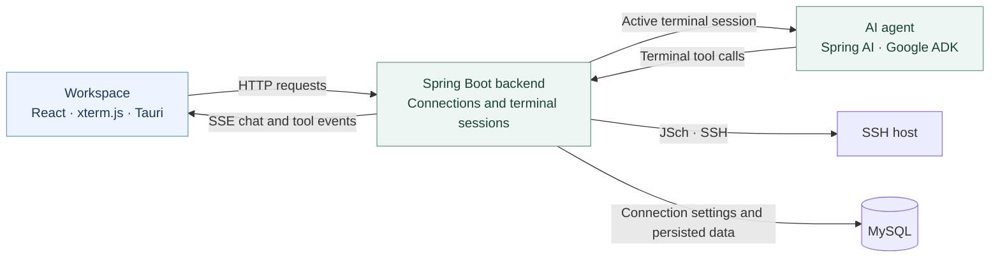

# MindShell

[中文](README.md) · **English**

**An SSH terminal and AI troubleshooting assistant in one workspace.**

MindShell is built for on-call engineers, routine service checks, and incident triage. Open a saved SSH connection, inspect the host in an interactive terminal, and use the chat panel to interpret logs and command output. Keeping the connection, terminal, and conversation together cuts down on context switching and copying output between tools.

[Operations workflow](#operations-workflow) · [Run locally](#run-locally) · [Configure agents](#configure-agents) · [Project layout](#project-layout)

## Operations workflow

| Task | How MindShell helps |
| --- | --- |
| Switch between frequently used hosts | Save connection settings and reopen an interactive terminal for the host from the workspace. |
| Investigate an unhealthy service | Start a chat beside the active terminal. The agent can use that terminal session to check service status, explain unexpected output, and suggest what to inspect next. |
| Follow the investigation | Server-Sent Events (SSE) stream tool calls and responses so you can follow the conversation and cross-check what you see in the terminal. |

**On-call scenario · A service starts returning errors**

1. Open the connection to a test host you are authorized to access. Check the service status and identify the relevant log window in the terminal.
2. Choose **SSH AI Agent** from the agent picker on the right. Give it the service name and time range. For example, *Review this service's error logs from the past 10 minutes. Group errors by frequency, flag the clues worth checking first, and run only read-only checks.*
3. Compare the agent's findings with the terminal output before deciding whether to inspect dependencies, configuration, or recent changes.

## Architecture



> [!NOTE]
> The current setup is intended for local development and trusted networks. SSH host key verification is disabled, so verify the destination host and account permissions before connecting. Logs or command output sent to the agent may be shared with the configured model provider. Redact sensitive information first.

## Run locally

Install JDK 17 or later, Maven, Node.js 22.12 or later, and MySQL 8. You can run MySQL with Docker Compose. The desktop app also requires Rust and the Tauri prerequisites for your platform. The commands below use Windows PowerShell.

### 1. Set environment variables

Open PowerShell at the repository root and use [`.env.example`](.env.example) as a reference. Replace the example values with your own settings.

```powershell
$env:MINDSHELL_DB_USER = "mindshell"
$env:MINDSHELL_DB_PASSWORD = "<database user password>"
$env:MINDSHELL_DB_ROOT_PASSWORD = "<database administrator password>"
$env:MINDSHELL_SECRET_KEY = "<independently generated random key>"
$env:MINDSHELL_AI_BASE_URL = "https://api.example.com/v1"
$env:MINDSHELL_AI_API_KEY = "<model API key>"
$env:MINDSHELL_AI_MODEL = "<model ID>"
```

Use the base URL of your OpenAI-compatible API, including any version prefix required by the provider. `MINDSHELL_SECRET_KEY` encrypts saved SSH credentials. Keep the same key across restarts so the application can still read those entries.

### 2. Initialize MySQL

From the repository root in the same PowerShell session, run:

```powershell
docker compose -f mindshell-server/docs/dev-ops/docker-compose-environment.yml up -d
```

The local MySQL port is `13306`. The initialization script runs on startup with an empty data directory. If you already have MySQL 8, have an administrator run [`mindshell.sql`](mindshell-server/docs/dev-ops/mysql/sql/mindshell.sql) and grant the application account access to the database. Then point `MINDSHELL_DB_URL` at your JDBC URL.

### 3. Start the backend

Run the following in the same PowerShell session. The backend listens on port `8091` by default.

```powershell
Set-Location mindshell-server
mvn -DskipTests package
java -jar mindshell-server-app/target/mindshell-server-app.jar
```

### 4. Start the web or desktop app

Open a separate PowerShell session at the repository root and run:

```powershell
Set-Location mindshell-client
npm.cmd ci
npm.cmd run dev
```

Open [localhost:5173](http://localhost:5173). Vite proxies `/api` requests to the local backend. To open the desktop app, stop the running Vite process and run `npm.cmd run tauri dev` from the same directory. Tauri starts the frontend dev server as part of that command.

## Configure agents

Agents are defined on the server in YAML. With the default `dev` profile, [`application-dev.yml`](mindshell-server/mindshell-server-app/src/main/resources/application-dev.yml) loads [`ssh-agent.yml`](mindshell-server/mindshell-server-app/src/main/resources/agent/ssh-agent.yml) through `spring.config.import`. When the backend finishes starting, it assembles the model, agent, and runner from that configuration.

### Add a log analysis assistant

In [`mindshell-server-app/src/main/resources/agent/`](mindshell-server/mindshell-server-app/src/main/resources/agent/), create `log-analysis-agent.yml` and paste in this configuration. The example interprets redacted logs and suggests what to check next. The `instruction` field guides the conversation, while the backend controls tool access.

```yaml
ai:
  agent:
    config:
      tables:
        logAnalysisAssistant:
          app-name: logAnalysisAssistant
          agent:
            agent-id: "100010"
            agent-name: Log Analysis Assistant
            agent-desc: Interprets logs and suggests what to check next
          module:
            ai-api:
              base-url: "${MINDSHELL_AI_BASE_URL}"
              api-key: "${MINDSHELL_AI_API_KEY}"
              completions-path: /chat/completions
              embeddings-path: /embeddings
            chat-model:
              model: "${MINDSHELL_AI_MODEL}"
            agents:
              - name: logAnalyst
                description: Explains service logs supplied by the user
                instruction: |
                  Use the redacted logs to summarize symptoms, evidence, and next checks.
                  Separate observations from hypotheses. If evidence is missing, specify which log excerpt would help.
                  Analyze only the text the user provides. Do not call terminal tools in this example.
                output-key: log_analysis
            runner:
              agent-name: logAnalyst
```

| Field | Purpose |
| --- | --- |
| `logAnalysisAssistant` under `tables` and `app-name` | The configuration key and application name. Choose distinct names for each configuration. |
| `agent.agent-id` | The ID registered by the backend and used by the client. Keep it unique across imported configurations. |
| `agent.agent-name` | The display name in the client dropdown. |
| `module.ai-api` and `module.chat-model` | Read the API base URL, API key, and model ID from environment variables. |
| `module.agents[].name` and `instruction` | The node name and its task instructions. |
| `module.runner.agent-name` | The entry point. It must match a defined agent or workflow node. |

### Enable and verify

Add the new file to the existing `spring.config.import` list in `application-dev.yml` alongside the default SSH agent.

```yaml
spring:
  config:
    import:
      - classpath:agent/ssh-agent.yml
      - classpath:agent/log-analysis-agent.yml
```

1. If you run the backend from source, restart it. If you run a JAR, rebuild it with the Maven command above and start the new JAR.
2. Refresh the client and look for **Log Analysis Assistant** in the **Select agent (`选择智能体`)** dropdown on the right. Open an authorized test SSH connection and submit a redacted log excerpt to try it.
3. If the agent does not appear, check the active Spring profile and `spring.config.import`, then review the backend startup logs. If assembly fails, check for duplicate configuration keys or agent IDs, verify that the runner entry matches the node name, and confirm the backend received all three model environment variables.

### Compose workflows

Define `agent-workflows` in the same `module` as the agent nodes. Use `sub-agents` to reference nodes by name. Define a referenced workflow before the workflow that uses it, then set `runner.agent-name` to the desired entry point.

| Type | Purpose |
| --- | --- |
| `sequential` | Runs nodes in order, such as collecting symptoms before summarizing likely causes. |
| `parallel` | Runs nodes concurrently to examine different aspects of the input. |
| `loop` | Repeats the same nodes up to the limit set by `max-iterations`. |

[`parallel_research_app.yml`](mindshell-server/mindshell-server-app/src/main/resources/agent/parallel_research_app.yml) defines three research agents, a parallel workflow, and a sequential workflow that combines their results. This excerpt shows how the nodes connect inside `module`.

```yaml
agent-workflows:
  - type: parallel
    name: ParallelWebResearchAgent
    description: Collects information on three topics in parallel
    sub-agents:
      - RenewableEnergyResearcher
      - EVResearcher
      - CarbonCaptureResearcher
  - type: sequential
    name: ResearchAndSynthesisPipeline
    description: Combines the results from the research agents
    sub-agents:
      - ParallelWebResearchAgent
      - SynthesisAgent
runner:
  agent-name: ResearchAndSynthesisPipeline
```

To try this optional workflow, add its YAML file to `spring.config.import` and configure the MCP tool service as specified in the example.

## Project layout

| Directory | Contents |
| --- | --- |
| [`mindshell-client/`](mindshell-client/) | The workspace built with React, TypeScript, Vite, xterm.js, and Tauri. |
| [`mindshell-server/`](mindshell-server/) | The Java 17 backend with Spring Boot, Spring AI, Google ADK, JSch, and MyBatis. |
| [`mindshell-server/docs/dev-ops/`](mindshell-server/docs/dev-ops/) | Database initialization, container configuration, and API examples. |

Run `npm.cmd run build` from the client directory to check the production build. Run `mvn -DskipTests package` from the server directory to package the backend. Use dedicated test configuration and hosts when testing model, MCP, or SSH integrations.
