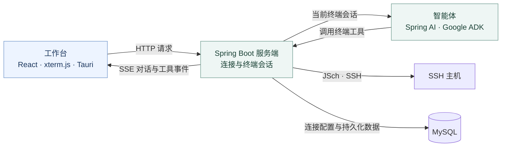

# MindShell

**中文** · [English](README.en.md)

**SSH 终端和 AI 排障，放在同一个工作台。**

MindShell 面向日常值班、服务巡检和故障排查。打开保存的 SSH 连接，在交互终端查看现场，再从右侧对话面板让 AI 解读日志和命令输出。连接、终端和对话在同一处，排查时少切应用、少复制输出，也更容易跟上每一步的结果。

[运维怎么用](#运维怎么用) · [本地启动](#本地启动) · [装配智能体](#装配智能体) · [项目结构](#项目结构)

## 运维怎么用

| 任务 | MindShell 帮你做什么 |
| --- | --- |
| 切换常用主机 | 保存连接配置，从同一工作台重新打开目标主机的交互终端。 |
| 排查服务异常 | 在当前终端旁边发起 AI 对话，让它结合该会话查看状态、解释异常输出，给出下一步检查方向。 |
| 跟踪检查过程 | 对话通过 SSE 返回结果，可边看工具调用与反馈，边对照终端确认现场。 |

**值班场景 · 服务刚开始报错**

1. 从连接列表打开有权限的测试主机，在终端确认服务状态和日志范围。
2. 在右侧选择 **SSH AI Agent**，告诉它服务名和时间范围。例如：*查看这项服务过去 10 分钟的错误日志，按出现频次归类，指出值得优先核实的线索。只做查询。*
3. 对照终端和流式反馈复核线索，再决定要不要查依赖、配置或近期变更。

## 系统怎么协作



> [!NOTE]
> 当前版本适用于本地开发和可信网络。SSH 主机密钥校验在现有实现中关闭，使用时请确认目标主机和账号权限。发送给 AI 的日志或命令输出可能随请求传给配置的模型服务，先处理其中的敏感信息。

## 本地启动

准备 JDK 17 或以上、Maven、Node.js 22.12 或以上，以及 MySQL 8。数据库可用 Docker Compose 启动。桌面端另外需要 Rust 和 Tauri 平台依赖。

### 1. 配置环境变量

在项目根目录打开 PowerShell，参考 [`.env.example`](.env.example) 设置变量。将示例值替换为自己的配置。

```powershell
$env:MINDSHELL_DB_USER = "mindshell"
$env:MINDSHELL_DB_PASSWORD = "<数据库用户密码>"
$env:MINDSHELL_DB_ROOT_PASSWORD = "<数据库管理员密码>"
$env:MINDSHELL_SECRET_KEY = "<独立生成的随机密钥>"
$env:MINDSHELL_AI_BASE_URL = "https://api.example.com/v1"
$env:MINDSHELL_AI_API_KEY = "<模型 API Key>"
$env:MINDSHELL_AI_MODEL = "<模型 ID>"
```

模型地址填写 OpenAI 兼容 API 的根地址，包含服务商要求的版本前缀。`MINDSHELL_SECRET_KEY` 用于加密已保存的 SSH 凭据，后续启动须使用同一密钥。

### 2. 初始化 MySQL

在设置了环境变量的终端，从项目根目录执行。

```powershell
docker compose -f mindshell-server/docs/dev-ops/docker-compose-environment.yml up -d
```

本机连接端口为 `13306`，空数据目录首次启动时会执行初始化 SQL。如果已有 MySQL 8，可以由管理员运行 [`mindshell.sql`](mindshell-server/docs/dev-ops/mysql/sql/mindshell.sql)，给应用账户授予数据库访问权限，再用 `MINDSHELL_DB_URL` 配置实际 JDBC 地址。

### 3. 启动后端

在同一终端执行。服务端默认监听 `8091`。

```powershell
Set-Location mindshell-server
mvn -DskipTests package
java -jar mindshell-server-app/target/mindshell-server-app.jar
```

### 4. 启动 Web 或桌面端

另开一个终端，从项目根目录执行。

```powershell
Set-Location mindshell-client
npm.cmd ci
npm.cmd run dev
```

打开 [localhost:5173](http://localhost:5173)。Vite 会把 `/api` 代理到本机后端。要开桌面端，先结束上面的 Vite 进程，再从同一目录运行 `npm.cmd run tauri dev`。Tauri 会启动所需的前端开发服务。

## 装配智能体

智能体由服务端 YAML 定义。默认 `dev` 环境在 [`application-dev.yml`](mindshell-server/mindshell-server-app/src/main/resources/application-dev.yml) 的 `spring.config.import` 导入 [`ssh-agent.yml`](mindshell-server/mindshell-server-app/src/main/resources/agent/ssh-agent.yml)，后端启动完成时按配置装配模型、Agent 和 Runner。

### 新增一个日志分析助手

在 [`mindshell-server-app/src/main/resources/agent/`](mindshell-server/mindshell-server-app/src/main/resources/agent/) 新建 `log-analysis-agent.yml`，复制下面的完整配置。示例用于解释给定的脱敏日志和整理检查方向，`instruction` 定义交互行为，工具权限由服务端实现决定。

```yaml
ai:
  agent:
    config:
      tables:
        logAnalysisAssistant:
          app-name: logAnalysisAssistant
          agent:
            agent-id: "100010"
            agent-name: 日志分析助手
            agent-desc: 解读日志并归纳下一步检查方向
          module:
            ai-api:
              base-url: "${MINDSHELL_AI_BASE_URL}"
              api-key: "${MINDSHELL_AI_API_KEY}"
              completions-path: /chat/completions
              embeddings-path: /embeddings
            chat-model:
              model: "${MINDSHELL_AI_MODEL}"
            agents:
              - name: logAnalyst
                description: 解释用户提供的服务日志
                instruction: |
                  根据用户提供的脱敏日志归纳现象、证据和下一步检查项。
                  区分已观察到的事实与推测。缺少信息时指出还需要哪一段日志。
                  在本示例中只分析给定文本，不调用终端工具。
                output-key: log_analysis
            runner:
              agent-name: logAnalyst
```

| 字段 | 用途 |
| --- | --- |
| `tables` 下的 `logAnalysisAssistant` 和 `app-name` | 配置键与应用名称。为新配置取独立名称，便于区分和定位。 |
| `agent.agent-id` | 后端注册和前端选用的 ID，在已导入的配置中保持唯一。 |
| `agent.agent-name` | 客户端下拉框中的显示名称。 |
| `module.ai-api` 和 `module.chat-model` | 从环境变量读取接口地址、密钥和模型名。 |
| `module.agents[].name` 和 `instruction` | 节点名称和该节点的任务指令。 |
| `module.runner.agent-name` | 启动入口，填写一个已定义的 Agent 节点名或工作流名。 |

### 启用并确认

在 `application-dev.yml` 的现有 `spring.config.import` 列表中追加新文件。原来的默认 Agent 入口一并保留。

```yaml
spring:
  config:
    import:
      - classpath:agent/ssh-agent.yml
      - classpath:agent/log-analysis-agent.yml
```

1. 从 IDE 等源码入口运行时，重启后端。运行 JAR 时，先用前文的 Maven 命令重新打包，再启动新的 JAR。
2. 刷新客户端，在右侧 **选择智能体** 下拉框查看「日志分析助手」。建立有权限的测试 SSH 连接后，可以提交一段脱敏日志进行验证。
3. 名称没出现时，先确认当前 Spring Profile 和 `spring.config.import`，再检查后端启动日志。装配报错时，核对配置键和 Agent ID 是否重复、Runner 的入口名是否拼写一致，以及三个模型环境变量是否传入后端进程。

### 组合工作流

在同一个 `module` 中定义 `agent-workflows`。`sub-agents` 填已有的节点名。引用另一个工作流时，先定义被引用的工作流。最后通过 `runner.agent-name` 指定入口。

| 类型 | 用途 |
| --- | --- |
| `sequential` | 按列表顺序执行，适合先收集现象、再归纳线索。 |
| `parallel` | 并行执行各子节点，适合分别分析不同维度的输入。 |
| `loop` | 反复执行同一组子节点，用 `max-iterations` 限制最大轮数。 |

[`parallel_research_app.yml`](mindshell-server/mindshell-server-app/src/main/resources/agent/parallel_research_app.yml) 已定义三个研究子节点、一个并行工作流和一个串行汇总入口。下面是该示例的入口关系，字段位于 `module` 内。

```yaml
agent-workflows:
  - type: parallel
    name: ParallelWebResearchAgent
    description: 并行收集三个主题的信息
    sub-agents:
      - RenewableEnergyResearcher
      - EVResearcher
      - CarbonCaptureResearcher
  - type: sequential
    name: ResearchAndSynthesisPipeline
    description: 汇总各子节点的结果
    sub-agents:
      - ParallelWebResearchAgent
      - SynthesisAgent
runner:
  agent-name: ResearchAndSynthesisPipeline
```

该示例默认未启用。需要试用时，在 `spring.config.import` 中启用对应 YAML，并按文件内的配置准备 MCP 工具服务。

## 项目结构

| 目录 | 内容 |
| --- | --- |
| [`mindshell-client/`](mindshell-client/) | React、TypeScript、Vite、xterm.js 和 Tauri 工作台。 |
| [`mindshell-server/`](mindshell-server/) | Java 17、Spring Boot、Spring AI、Google ADK、JSch 与 MyBatis。 |
| [`mindshell-server/docs/dev-ops/`](mindshell-server/docs/dev-ops/) | 数据库初始化、容器配置和 API 示例。 |

可运行 `npm.cmd run build` 检查前端生产构建。后端打包用 `mvn -DskipTests package`。需要测试模型、MCP 或 SSH 集成时，请使用单独的测试配置和主机。
